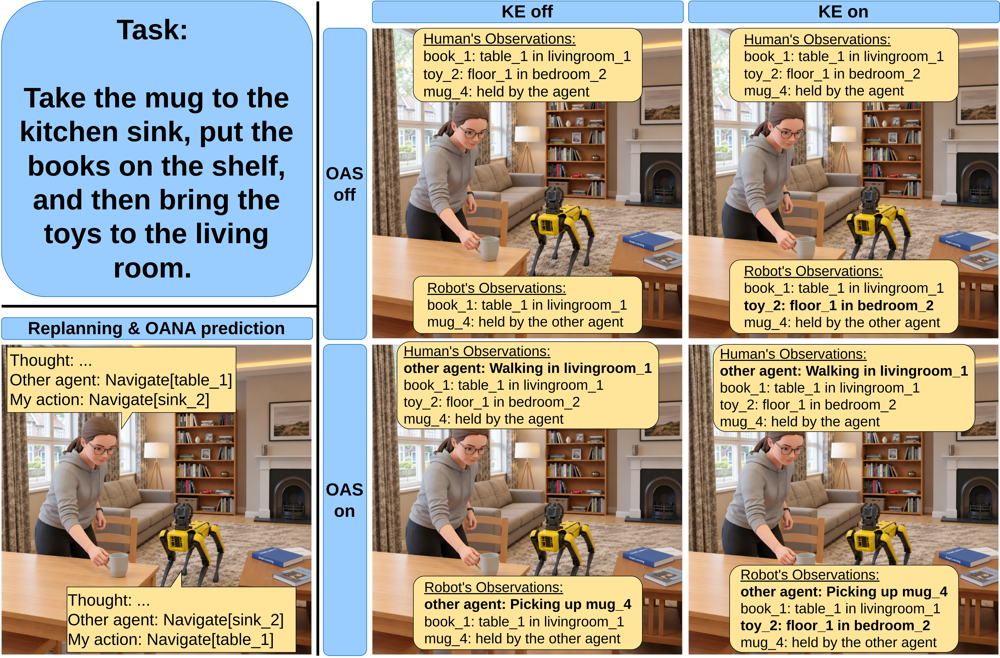
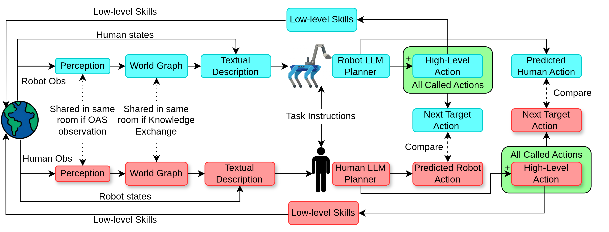

# Observe, Share, or Predict? Disentangling Partner Information in Embodied Multi-Agent Collaboration
This repository is extending facebookresearch's [partnr-planner](https://github.com/facebookresearch/partnr-planner) from commit [ddfff19](https://github.com/facebookresearch/partnr-planner/commit/ddfff19f4b6c098a31edea4d19e7b75db72433c2). We introduce a new Decoupled Partial observability regime, augment agents with Other Agent State (OAS) observation and object Knowledge Exchange (KE) when agents are co-located, and Other Agent Next Action (OANA) prediction. It includes instructions for downloading and running the PARTNR benchmark and our experiments in the Habitat simulator and implements Large Language Model (LLM) based planners.



In [PARTNR's](https://github.com/facebookresearch/partnr-planner) decentralized baseline, the robot agent has access to the human agent's perception. For this reason, we introduce the Decoupled Partial Observability in PARTNR, where the robot agent doesn't have this access anymore, and both agents use only their own perception in the simulator.

If the agents are allowed to observe the OAS, then if they are in the same room, they share perception (to avoid inconsistencies between perceived objects and OAS observation), and they also observe the state sequence of the partner agent. If the agents are in different rooms, their OAS observation is 'Acting in another room'. In Full Observability, the agents always observe the OAS.

To allow more interaction between the agents, who are in the same room, they can also change their knowledge about their observed objects (KE). In the Full Observability scenario, the agents use the full world graph, so this setting is not applicable.

At each replanning, if enabled, the agents can also reason about and predict the OANA.

In our [paper](), we test and analyze the role of OAS observation, the object KE, and the OANA prediction in multi-agent collaboration.

## Overview

This codebase contains abstractions for enabling agents to follow free form natural language instructions in the Habitat simulator. The main abstractions are - **Agent**, **Planner**, **Tool**, and **Skill**. The agent has access to a set of tools which can allow it to perceive the state of the environment, or interact with the environment using low level skills. This repository also contains  the codebase for generating PARTNR datasets using LLMs.

## Code Organization

Below are the details of various important directories and classes.

- **habitat-llm**
    - **Agent**   : Represents the robot or human. An agent can act in the environment.
    - **Tools**   : Represents abstractions which enable the agent to perceive or act in the environment.
    - **Planner** : Represents centralized and decentralized planners.
    - **LLM**     : Contains abstractions to represent Llama and GPT APIs.
    - **WorldGraph** : Contains a hierarchical world graph representing rooms, furniture, objects.
    - **Perception** : Contains a simulated perception pipeline which sends local detections to the world model.
    - **Examples**: Contains demos and evaluation programs to show or analyze the performance of planners.
    - **EvaluationRunner**: Represents an abstraction for running the planners.
    - **Conf**    : Contains hydra config files for all classes.
    - **Utils**   : Contains various utility methods required throughout the codebase.
    - **Tests**   : Contains unit tests.
- **scripts**
    - **hitl_analysis** : Contains scripts to analyze and replay human-in-the-loop traces.
    - **prediviz** : Contains visualization and annotation tools for PARTNR tasks.


## Decoupled architecture with Other Agent’s State (OAS) observation and Other Agent’s Next Action (OANA) prediction.

Both agents build a world graph using their own environmental object observations and their actions. The graph’s nodes represent the house, rooms, furniture, receptacles, objects, and the agents. The edges represent the type of relation between them. If allowed, the agents also observe the OAS and exchange their knowledge about the objects when they are in the same room. Their high-level LLM planners call a High-Level Action (at replanning) and the corresponding low-level skills (action execution in the simulator), and predict the OANA. The predicted OANA is then compared with the next target action retrieved from the list of All Called High-Level Actions of the other agent.

<p align="center">
  
</p>

## Installation

For installation, refer to [INSTALLATION.md](INSTALLATION.md)

## Quickstart

Baselines for a variety of agent configuration are runnable with the provided configurations. Select any of the baselines from [habitat_llm/conf/baselines](./habitat_llm/conf/baselines/). You may need to specify one or two LLMs based on the baseline. Set the inference mode to `hf` and specify the huggingface model to use for inference. Model weights will be downloaded automatically if they are not found. Below are examples using Llama-3.1-8B running on the `val_mini` data split. Replace `val_mini` with one of `[train_2k, val, train, val_mini]` to run other splits. If you are using local custom path to the weights of the LLM instead of only the huggingface ID for llama 3 models, make sure the string "Llama-3" appears in the path to the weights. The grammar constraining code looks for this string in the path to determine how to load the tokenizer.

### Decentralized Multi-Agent React Summary using Decoupled Partial Observability
```bash
python -m habitat_llm.examples.planner_demo --config-name baselines/decentralized_zero_shot_react_summary_decoupled.yaml \
    habitat.dataset.data_path="data/datasets/partnr_episodes/v0_0/val_mini.json.gz" \
    evaluation.agents.agent_0.planner.plan_config.llm.inference_mode=hf \
    evaluation.agents.agent_1.planner.plan_config.llm.inference_mode=hf \
    evaluation.agents.agent_0.planner.plan_config.llm.generation_params.engine=meta-llama/Meta-Llama-3-8B-Instruct \
    evaluation.agents.agent_1.planner.plan_config.llm.generation_params.engine=meta-llama/Meta-Llama-3-8B-Instruct
```
### Experiment configs
Use the command above with the appropriate configs below to run experiments with Decoupled Partial or Full Observability, OAS observation, object KE, and OANA prediction.

```bash
baselines/decentralized_zero_shot_react_summary_decoupled.yaml 
baselines/decentralized_zero_shot_react_summary_decoupled_predict_oana.yaml
baselines/decentralized_zero_shot_react_summary_decoupled_same_room_knowledge_exchange.yaml 
baselines/decentralized_zero_shot_react_summary_decoupled_predict_oana_and_same_room_knowledge_exchange.yaml 
baselines/decentralized_zero_shot_react_summary_decoupled_observe_oas_same_room.yaml 
baselines/decentralized_zero_shot_react_summary_decoupled_predict_oana_and_observe_oas_same_room.yaml 
baselines/decentralized_zero_shot_react_summary_decoupled_observe_oas_same_room_knowledge_exchange.yaml 
baselines/decentralized_zero_shot_react_summary_decoupled_predict_oana_and_observe_oas_same_room_knowledge_exchange.yaml 
```

```bash
baselines/decentralized_zero_shot_react_summary_full_obs.yaml 
baselines/decentralized_zero_shot_react_summary_predict_oana_full_obs.yaml 
baselines/decentralized_zero_shot_react_summary_observe_oas_full_obs.yaml 
baselines/decentralized_zero_shot_react_summary_predict_oana_and_observe_oas_full_obs.yaml 
```

## Inference backends

The same experiments can be run with four LLM backends. The backend is selected by the config you pass to `--config-name` and, for vLLM, by a few extra overrides.

| Backend | Baseline configs | LLM config | Requires |
|---|---|---|---|
| Local HuggingFace (`hf`) | `baselines/*.yaml` | [llm/llama.yaml](./habitat_llm/conf/llm/llama.yaml) | GPU(s) that fit the model |
| vLLM server | `baselines/*.yaml` + `llm=vllm` overrides | [llm/vllm.yaml](./habitat_llm/conf/llm/vllm.yaml) | A running vLLM server |
| OpenRouter API | `baselines/openrouter/*_openrouter.yaml` | [llm/openrouter_chat.yaml](./habitat_llm/conf/llm/openrouter_chat.yaml) | `OPENROUTER_API_KEY` |
| OpenAI API | `baselines/openai/*_openai.yaml` | [llm/openai_standard_chat.yaml](./habitat_llm/conf/llm/openai_standard_chat.yaml) | `OPENAI_API_KEY` |

### API keys

The API backends read the key from an environment variable (`api_key_env` in the LLM config). Export it in your shell, or put it in `~/.bashrc`:

```bash
export OPENROUTER_API_KEY=<your-openrouter-key>   # OpenRouter
export OPENAI_API_KEY=<your-openai-key>           # OpenAI
```

### OpenRouter

Pick a config from [habitat_llm/conf/baselines/openrouter](./habitat_llm/conf/baselines/openrouter/) and set the model with `generation_params.model` for both agents. The model name is the OpenRouter model ID, e.g. `google/gemini-3.1-flash-lite` (the default in `openrouter_chat.yaml`) or `deepseek/deepseek-v3.2`.

```bash
export OPENROUTER_API_KEY=<your-openrouter-key>

MODEL_PATH=google/gemini-3.1-flash-lite
CONFIG_NAME=baselines/openrouter/decentralized_zero_shot_react_summary_decoupled_openrouter.yaml
OUTPUT_DIR=outputs/habitat_llm/$(date +%Y-%m-%d_%H-%M-%S)-decoupled_gemini_3_1_flash_lite-val.json

python -m habitat_llm.examples.planner_demo \
  --config-name $CONFIG_NAME \
  habitat.dataset.data_path="data/datasets/partnr_episodes/v0_0/val.json.gz" \
  evaluation.agents.agent_0.planner.plan_config.llm.generation_params.model=$MODEL_PATH \
  evaluation.agents.agent_1.planner.plan_config.llm.generation_params.model=$MODEL_PATH \
  hydra.run.dir=$OUTPUT_DIR \
  num_proc=4
```

### OpenAI

Same command, with a config from [habitat_llm/conf/baselines/openai](./habitat_llm/conf/baselines/openai/) and an OpenAI model name (default `gpt-4o-mini`):

```bash
export OPENAI_API_KEY=<your-openai-key>

MODEL_PATH=gpt-4o-mini
CONFIG_NAME=baselines/openai/decentralized_zero_shot_react_summary_decoupled_openai.yaml
OUTPUT_DIR=outputs/habitat_llm/$(date +%Y-%m-%d_%H-%M-%S)-decoupled_gpt4o_mini-val.json

python -m habitat_llm.examples.planner_demo \
  --config-name $CONFIG_NAME \
  habitat.dataset.data_path="data/datasets/partnr_episodes/v0_0/val.json.gz" \
  evaluation.agents.agent_0.planner.plan_config.llm.generation_params.model=$MODEL_PATH \
  evaluation.agents.agent_1.planner.plan_config.llm.generation_params.model=$MODEL_PATH \
  hydra.run.dir=$OUTPUT_DIR \
  num_proc=4
```

### API experiment configs

The API configs mirror the local ones. The full name is `baselines/<provider>/decentralized_zero_shot_react_summary_<setting>_<provider>.yaml`, where `<provider>` is `openrouter` or `openai`.

| Experiment | `<setting>` |
|---|---|
| Decoupled Partial Observability | `decoupled` |
| + OANA | `decoupled_predict_oana` |
| + KE | `decoupled_same_room_knowledge_exchange` |
| + OANA + KE | `decoupled_predict_oana_same_room_knowledge_exchange` |
| + OAS | `decoupled_observe_oas_same_room` |
| + OANA + OAS | `decoupled_predict_oana_and_observe_oas_same_room` | 
| + OAS + KE | `decoupled_observe_oas_same_room_knowledge_exchange` |
| + OANA + OAS + KE | `decoupled_predict_oana_and_observe_oas_same_room_knowledge_exchange` |
| Full Observability | `full_obs` |
| Full Observability + OANA | `predict_oana_full_obs` |
| Full Observability + OAS | `observe_oas_full_obs` |
| Full Observability + OANA + OAS | `predict_oana_and_observe_oas_full_obs` |

Notes for the API backends:
- Both agents use the same model unless you give `agent_0` and `agent_1` different `generation_params.model` values. The OANA prediction is produced in the same LLM call as the agent's own next action, so there is no separate model to configure for it.
- `num_proc` is the number of episodes run in parallel, and therefore the number of concurrent API requests. Lower it if you hit the provider's rate limits (free OpenRouter models in particular).
- Grammar-constrained decoding is not available through the chat APIs: `constrained_generation` has no effect here and the output format is enforced only by the prompt.
- Each replanning step is a paid API call. Try a run on `val_mini.json.gz` before starting a full `val` run.

### vLLM

vLLM serves a local model through an OpenAI-compatible HTTP server, which is faster than `hf` inference and lets several episodes share one loaded model. Start the server first, then run any config from `baselines/*.yaml` with the vLLM overrides:

```bash
python -m habitat_llm.examples.planner_demo \
  --config-name baselines/decentralized_zero_shot_react_summary_decoupled.yaml \
  habitat.dataset.data_path="data/datasets/partnr_episodes/v0_0/val.json.gz" \
  llm@evaluation.agents.agent_0.planner.plan_config.llm=vllm \
  llm@evaluation.agents.agent_1.planner.plan_config.llm=vllm \
  evaluation.agents.agent_0.planner.plan_config.llm.inference_mode=vllm \
  evaluation.agents.agent_1.planner.plan_config.llm.inference_mode=vllm \
  evaluation.agents.agent_0.planner.plan_config.llm.generation_params.engine=Meta-Llama-3.1-8B-Instruct \
  evaluation.agents.agent_1.planner.plan_config.llm.generation_params.engine=Meta-Llama-3.1-8B-Instruct \
  evaluation.agents.agent_0.planner.plan_config.llm.hf_fallback_model=meta-llama/Meta-Llama-3.1-8B-Instruct \
  evaluation.agents.agent_1.planner.plan_config.llm.hf_fallback_model=meta-llama/Meta-Llama-3.1-8B-Instruct \
  num_proc=8
```

Server setup, the 70B 4-bit variant, running the server in a separate docker container, and troubleshooting are described in [VLLM_INTEGRATION_SUMMARY.md](./VLLM_INTEGRATION_SUMMARY.md).

### Resuming a run

`+resume=true` skips every episode that already has a planner log in `hydra.run.dir` and runs only the missing ones. To continue an interrupted run, set `hydra.run.dir` (`OUTPUT_DIR` above) to the existing run folder instead of a new timestamped one and start the same command again. On a new folder the flag has no effect, so it is safe to always pass it.


## Calculating Results
You can check the progress of the run and the results so far using
`python scripts/read_results.py <output_dir>/<dataset_name>`. The default `output_dir` is `outputs/habitat_llm/<timestamp>-<dataset_name>`. This can be overridden using the `paths.results_dir` and `evaluation.output_dir` configuration elements. The output directory also contains the full text traces of the rollouts and other statistics.

## Compute task metrics
```bash
python scripts/compute_metrics_summary.py <experiment_folder>
```

## Compute collaboration metrics
```bash
python scripts/compute_collaboration_metrics.py --output-dir <experiment_folder> --dataset val
```

## Evaluate OANA prediction
```bash
python scripts/oana_pred_eval.py <relative_path_to_experiment_folder>
```

## Testing episodes

To test whether a dataset is runnable and the success at step 0, run the following command. Set the `habitat.dataset.data_path` to the dataset you want to test.

```bash
HYDRA_FULL_ERROR=1 python -m habitat_llm.examples.verify_episodes \
    --config-name examples/planner_multi_agent_demo_config.yaml \
    hydra.run.dir="." \
    evaluation=centralized_evaluation_runner_multi_agent \
    habitat.dataset.data_path="data/datasets/partnr_episodes/v0_0/val_mini.json.gz" \
    mode='data' \
    world_model.partial_obs='False' \
    evaluation.type="centralized" \
    num_proc=5
```

#### SkillRunner: Running Oracle Skills in a Sandbox Environment

The habitat_llm/examples/skill_runner.py application provides a headless command line interface (CLI) for running custom sequences of oracle skills within a sandbox environment for a given episode.

For example:
```bash
HYDRA_FULL_ERROR=1 python -m habitat_llm.examples.skill_runner hydra.run.dir="." +skill_runner_show_topdown=True habitat.dataset.data_path=data/datasets/partnr_episodes/v0_0/val_mini.json.gz +skill_runner_episode_id="334"
```
In the above example, episode `334` from the `val_mini.json.gz` dataset will be instantiated, the list of all active Entities (Rooms, Objects, Furniture, and Receptacles) will be printed to the console.

- By providing CLI option `+skill_runner_show_topdown=True`, the program will render and display a top-down view of the scene upon initialization.

- CLI option `+skill_runner_episode_index=` can be provided instead of `+skill_runner_episode_id=`, in which case the integer index will be used to query the episode from the dataset.

- Note that all environment config values can be overridden from the CLI and defaults are set in `habitat_llm/conf/examples/skill_runner_default_config.yaml`.

Once the Episode is initialized, the user will be presented with a list of available skills (e.g. Navigate, Pick, Place, Open, Close) and prompted to enter a command.

Commands can take the form of a skill call, for example:
```bash
Enter Command
> Navigate 0 table_10
```
would command agent 0 to execute the "OracleNavSkill" targeting Entity with name `table_10`. By default, a video of the full skill execution will be produced and displayed after skill completion along with skill output text printed to the console.

- All generated video will be saved to `paths.results_dir`, change this path by adding `paths.results_dir=<relative_path_to_directory>` to the CLI call.
- Video recording and playback can be disabled by setting `+skill_runner_make_video=false` in the CLI.

_NOTE: skill_runner currently supports only sequential skill execution for one agent at a time. For example, you cannot command both agents to simultaneously navigate. Primarily this restriction is motivated by the complexity of synchronizing skills with different execution lengths._

Additional non-skill commands include:
- `debug` - trigger a pdb breakpoint for open-ended debugging and attach a `DebugVisualizer` to local variable `dbv` for visual debugging.
- `exit` - quit the program.
- `help` - print the available skill text to the console.
- `entities` - print the list of available entities to the console.
- `make_video` - generate, display, and save a concatenation of all sequential skill execution videos.

## Using with ConceptGraphs

See detailed doc [here](./habitat_llm/concept_graphs/README.md)

## Finetuning a planning model

See detailed doc [here](./habitat_llm/finetuning/README.md)

## Extending the environment

For additional details about adding new agents, tools and custom actions see [here](./docs/extending.md)

## Citation

If you use our codebase in your research, please cite the [Observe, Share, or Predict? Disentangling Partner Information in Embodied Multi-Agent Collaboration]() paper


## License

partnr-planner is MIT licensed. See the [LICENSE](LICENSE) for details.
